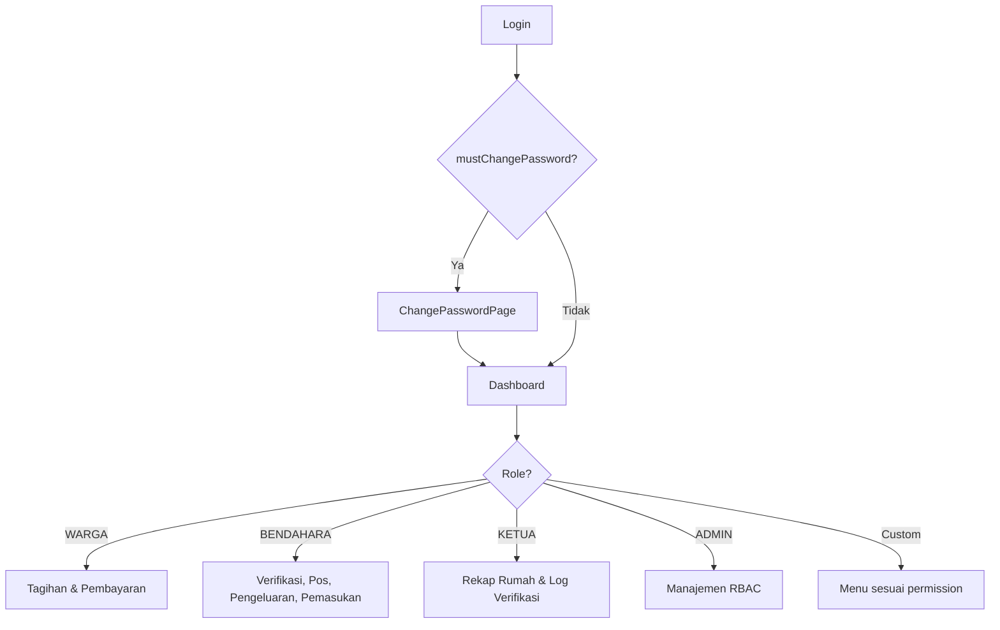

# AGENTS.md — KasKita Frontend

> Baca file ini di awal setiap sesi AI baru. Berisi ringkasan arsitektur, konvensi kode, dan panduan kontribusi proyek ini.

---

## 1. Gambaran Proyek

**KasKita** adalah aplikasi manajemen keuangan kas blok/lingkungan berbasis web.
Frontend ini dibangun dengan **React 19 + Vite 8 + TypeScript 7 + Tailwind CSS 4** dan terhubung langsung ke **Supabase** (tanpa backend server terpisah).

- **Nama aplikasi**: KasKita
- **Lokasi FE**: `d:/PRIBADI/Learning/KeunganForum/FE/`
- **Backend**: Supabase (Auth, Database, Edge Functions, RPC)
- **Deploy**: Vercel (SPA rewrite via `vercel.json`)
- **Linter**: oxlint

---

## 2. Struktur Folder

```
FE/
├── public/                   # Aset statis (favicon, icon SVG)
├── src/
│   ├── App.tsx               # Root app: routing & ProtectedRoute
│   ├── main.tsx              # Entry point React
│   ├── index.css             # Global styles (Tailwind + custom CSS)
│   ├── types.ts              # Semua TypeScript types/interfaces global
│   │
│   ├── auth/
│   │   ├── AuthContext.tsx   # React Context + hook useAuth()
│   │   └── AuthProvider.tsx  # Implementasi AuthProvider (loadUser, signIn, signOut, changePassword)
│   │
│   ├── components/
│   │   └── UI.tsx            # Komponen UI reusable: Button, Card, Notice, StatusBadge, SectionTitle, EmptyState, LoadingState
│   │
│   ├── hooks/
│   │   └── useResource.ts    # Hook generik untuk fetch data via api()
│   │
│   ├── lib/
│   │   ├── api.ts            # Lapisan "API" — semua query Supabase dipetakan dari path REST-like
│   │   ├── format.ts         # formatCurrency (IDR), formatDate (id-ID), safeProofUrl
│   │   ├── roles.ts          # dashboardPathForRole(role) → redirect path per peran
│   │   └── supabase.ts       # getSupabase() singleton, usernameToAuthEmail()
│   │
│   └── pages/
│       ├── LoginPage.tsx         # Halaman login (username + password)
│       ├── ChangePasswordPage.tsx# Ganti password wajib saat login pertama
│       ├── DashboardPage.tsx     # Dashboard utama: sidebar nav, tab switching, ringkasan kas
│       └── dashboard/
│           ├── WorkspacePanels.tsx   # Panel per role: WargaWorkspace, BendaharaWorkspace, KetuaWorkspace
│           └── RbacManagementPanel.tsx # Manajemen RBAC: users, role-menu matrix (khusus ADMIN)
│
├── docs/
│   ├── AGENTS.md             # ← file ini
│   └── ALUR_PEMBAYARAN.md    # Dokumentasi lengkap alur tagihan, pembayaran & verifikasi (Warga ↔ Bendahara)
├── .env.example              # Template env vars
├── .env.local                # Env lokal (tidak di-commit)
├── vite.config.ts            # Plugin: @vitejs/plugin-react, @tailwindcss/vite
├── vercel.json               # SPA rewrite: semua route → index.html
└── package.json
```

---

## 3. Cara Jalankan

```bash
# Install dependencies
npm install

# Dev server
npm run dev

# Build produksi
npm run build

# Lint
npm run lint
```

**Environment variables** (isi di `.env.local`):
```
VITE_SUPABASE_URL=https://your-project.supabase.co
VITE_SUPABASE_ANON_KEY=your-supabase-anon-key
```

---

## 4. Arsitektur & Pola Kode

### 4.1 Autentikasi

- Supabase Auth digunakan dengan email internal buatan: `usernameToAuthEmail(username)` → `username@auth.kaskita.invalid`
- `AuthProvider` mendengarkan `onAuthStateChange` dan memuat profil user dari tabel `users`, role dari `roles`, dan menu dari `role_menus`
- Setelah login, jika `mustChangePassword === true`, user diarahkan ke `/change-password` sebelum bisa akses dashboard
- Context tersedia via hook `useAuth()` → `{ user, loading, startupError, signIn, signOut, refreshUser, changePassword }`

### 4.2 Routing

```
/                    → LoginPage (jika belum login) atau redirect ke dashboard sesuai role
/change-password     → ChangePasswordPage (wajib sebelum akses fitur lain)
/dashboard/warga     → ProtectedRoute role="WARGA"
/dashboard/bendahara → ProtectedRoute role="BENDAHARA"
/dashboard/ketua     → ProtectedRoute role="KETUA"
/dashboard/admin     → ProtectedRoute role="ADMIN"
/dashboard/custom    → ProtectedRoute untuk role custom (RBAC dinamis)
```

### 4.3 Layer API (`src/lib/api.ts`)

Tidak ada backend Express/Node. Semua request diimplementasikan langsung ke Supabase di dalam fungsi `api(path, options)`. Pola path mirip REST API konvensional, misalnya:

| Path | Method | Keterangan |
|------|--------|-----------|
| `/api/public/summary` | GET | RPC `get_public_finance_summary` |
| `/api/warga/bills` | GET | Tagihan warga (sinkronisasi otomatis bulanan dengan due_date) |
| `/api/warga/payments` | GET/POST | Query/submit pembayaran via RPC `submit_resident_payment` |
| `/api/bendahara/payments/pending` | GET | Daftar pembayaran pending |
| `/api/bendahara/payments/:id/approve` | POST | RPC `review_payment` |
| `/api/bendahara/payments/:id/reject` | POST | RPC `review_payment` |
| `/api/bendahara/funds` | GET/POST | CRUD pos keuangan |
| `/api/bendahara/funds/:id` | PUT/DELETE | Update dan Delete pos keuangan |
| `/api/bendahara/bills/generate` | POST | RPC `generate_bills` |
| `/api/bendahara/expenses` | GET/POST | CRUD pengeluaran |
| `/api/bendahara/income` | POST | RPC `record_other_income` |
| `/api/bendahara/payments/cash` | POST | RPC `record_cash_payment` |
| `/api/bendahara/users/:id/reset-password` | POST | Edge Function `reset-warga-password` |
| `/api/ketua/houses/arrears` | GET | View `v_house_arrears` |
| `/api/ketua/expenses` | GET | View `v_public_expenses` |
| `/api/ketua/verification-log` | GET | View `v_verification_log` |

> **Penting**: Jika menambah fitur baru, tambahkan handler baru di `api.ts` dengan pola yang sama. Jangan memanggil `getSupabase()` langsung dari komponen — selalu lewat `api()` atau `useResource()`.

### 4.4 Hook `useResource<T>`

```ts
const { data, loading, error, reload } = useResource<Bill[]>('/api/warga/bills')
```

- Otomatis fetch saat mount dan saat `path` berubah
- `reload()` untuk refresh manual setelah mutasi

### 4.5 Peran (Role)

| Role key | Halaman | Fitur utama |
|----------|---------|-------------|
| `WARGA` | `/dashboard/warga` | Lihat tagihan, ajukan pembayaran |
| `BENDAHARA` | `/dashboard/bendahara` | Verifikasi pembayaran, kelola pos, catat pengeluaran/pemasukan |
| `KETUA` | `/dashboard/ketua` | Pantau rekap rumah, log verifikasi |
| `ADMIN` | `/dashboard/admin` | Manajemen RBAC: users & role-menu matrix |
| Custom | `/dashboard/custom` | Akses sesuai menu yang diatur ADMIN |

### 4.6 RBAC Dinamis

- Tabel `roles`, `menus`, `role_menus` menentukan menu dan permission per role
- ADMIN dapat membuat role baru via RPC `create_rbac_role` dan mengatur permission via RPC `save_role_menu_matrix`
- Edge Function `admin-user-management` dipakai untuk create/update/set-active user (action: `'create'` | `'update'` | `'set-active'`)

---

## 5. Konvensi Kode

- **TypeScript strict** — semua type ada di `src/types.ts`. Hindari `any`; gunakan `unknown` lalu narrowing.
- **Penamaan**: camelCase untuk variabel/fungsi, PascalCase untuk komponen dan tipe.
- **CSS**: Custom class di `index.css`, Tailwind utility class di JSX. Hindari inline style.
- **Error handling**: Semua async selalu wrap dengan `try/catch`, tampilkan via komponen `<Notice>`.
- **Linter**: oxlint (bukan ESLint). Jalankan `npm run lint` sebelum commit.
- **Tidak ada test** saat ini — tambahkan jika diminta.
- **Komentar Bahasa Indonesia** dalam UI text dan error message (sesuai domain).

---

## 6. Supabase: Objek Database Penting

### Tabel
| Tabel | Keterangan |
|-------|-----------|
| `users` | Profil pengguna (linked ke Supabase Auth) |
| `roles` | Daftar role (WARGA, BENDAHARA, KETUA, ADMIN, custom) |
| `menus` | Daftar menu/fitur |
| `role_menus` | Matrix permission role × menu |
| `warga` | Data warga (linked ke `houses`) |
| `houses` | Data rumah (house_code, block_code, dll.) |
| `finance_funds` | Pos keuangan (RECURRING / EVENT) |
| `bills` | Tagihan per rumah per periode |
| `payments` | Riwayat pembayaran (PENDING / APPROVED / REJECTED) |
| `expenses` | Pengeluaran kas |

### View
| View | Keterangan |
|------|-----------|
| `v_public_expenses` | Pengeluaran yang bisa dilihat publik/warga |
| `v_house_arrears` | Rekap tunggakan per rumah |
| `v_verification_log` | Log verifikasi pembayaran oleh bendahara |

### RPC (Stored Procedures)
| RPC | Dipanggil dari |
|-----|----------------|
| `get_public_finance_summary` | `/api/public/summary` |
| `submit_resident_payment` | `/api/warga/payments` POST |
| `review_payment` | `/api/bendahara/payments/:id/approve|reject` |
| `create_fund` | `/api/bendahara/funds` POST |
| `generate_bills` | `/api/bendahara/bills/generate` |
| `create_expense` | `/api/bendahara/expenses` POST |
| `record_other_income` | `/api/bendahara/income` POST |
| `record_cash_payment` | `/api/bendahara/payments/cash` POST |
| `mark_password_changed` | `AuthProvider.changePassword()` |
| `save_role_menu_matrix` | `RbacManagementPanel.saveMatrix()` |
| `create_rbac_role` | `NewRoleForm` |
| `save_house_record` | `HouseRecordForm` — 5 param: house_id, block_code, house_number, head_name, **occupancy_status** (`OWNER_OCCUPIED`\|`RENTED`) |
| `set_house_active` | tombol Aktifkan/Nonaktifkan di `ArrearsPanel` |

### Edge Functions
| Function | Keterangan |
|----------|-----------|
| `reset-warga-password` | Reset PIN warga ke sementara (dipanggil bendahara) |
| `admin-user-management` | CRUD akun user (dipanggil ADMIN) |

---

## 7. Hal yang Perlu Diperhatikan

- **Jangan** commit `.env.local` — file ini di-gitignore.
- **Jangan** memanggil Supabase langsung dari komponen React, kecuali di `RbacManagementPanel` (yang memang query langsung karena kebutuhan khusus admin). Preferensikan lewat `api()`.
- **Username** dikonversi ke email internal sebelum ke Supabase Auth: `username → username@auth.kaskita.invalid`.
- **Money values** selalu gunakan `formatCurrency()` dari `src/lib/format.ts` untuk tampil ke user (format IDR, tanpa desimal).
- **Proof URL**: selalu validasi dengan `safeProofUrl()` sebelum render sebagai `<a href>`.
- Routing SPA: semua path di-redirect ke `index.html` via `vercel.json`. Jangan tambahkan backend route di sini.

---

## 8. Alur Kerja Umum



---

*Diperbarui terakhir: 2026-11-27. Jika ada perubahan arsitektur besar, perbarui file ini.*
