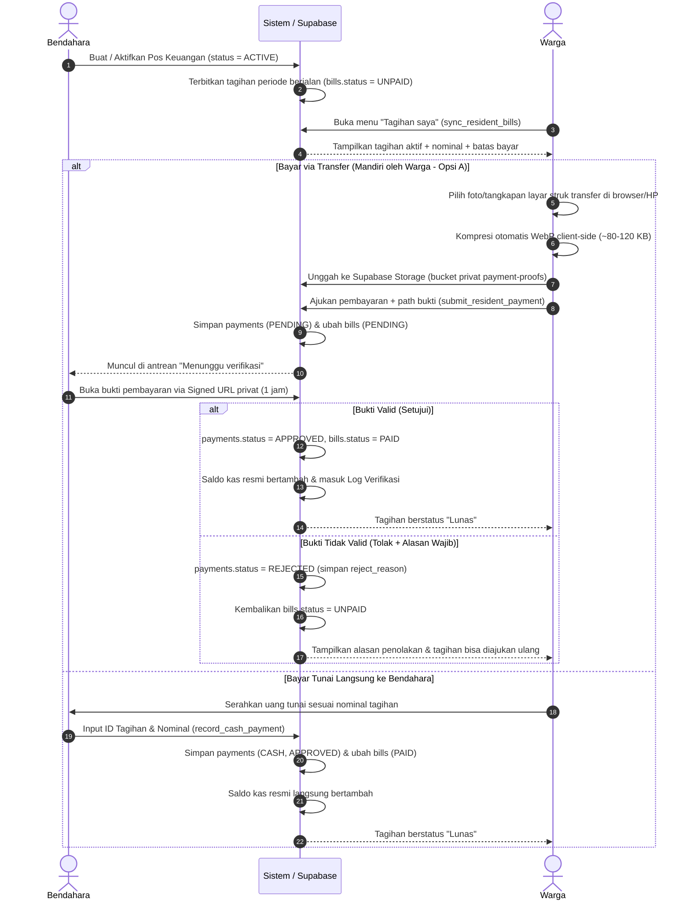
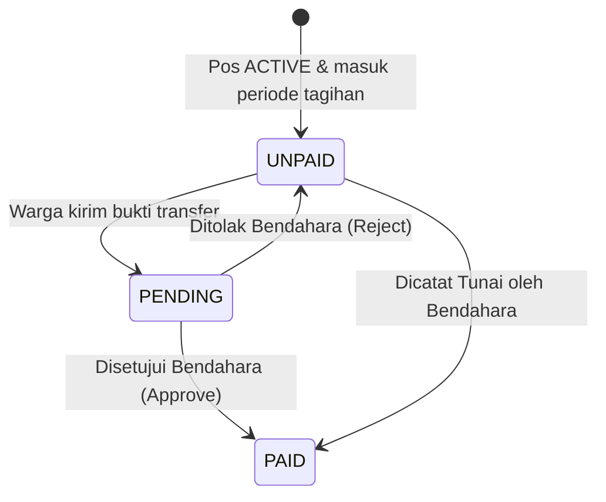

# Dokumentasi Alur Pembayaran — Warga & Bendahara (KasKita)

Dokumen ini menjelaskan alur bisnis dan teknis proses penagihan, pembayaran, hingga verifikasi antara **Warga** dan **Bendahara** pada aplikasi **KasKita**.

---

## 1. Gambaran Umum

Sistem pembayaran KasKita dirancang agar **transparan dan akuntabel**: setiap uang masuk ke saldo kas resmi harus terverifikasi oleh Bendahara, sementara riwayat pengajuan (disetujui maupun ditolak) tetap tercatat sebagai jejak audit.

Terdapat **3 jalur pembayaran/pemasukan**:
1. **Transfer Mandiri oleh Warga** — Warga mengajukan bukti transfer di dashboard, lalu Bendahara memeriksa dan menyetujui/menolak.
2. **Pembayaran Tunai (Cash) ke Bendahara** — Warga membayar tunai langsung ke Bendahara, dan Bendahara mencatat pelunasan tagihan secara langsung.
3. **Pemasukan Lain (Non-Tagihan)** — Bendahara mencatat donasi, sponsor, atau pemasukan di luar tagihan rumah.

---

## 2. Diagram Alur Utama (Warga ↔ Bendahara)

---

## 3. Siklus Status (State Machine)

### 3.1 Status Tagihan (`bills.status`)

| Status DB | Label UI | Arti |
|-----------|----------|------|
| `UNPAID` | **Belum lunas** | Tagihan sudah terbit dan siap dibayar/diajukan oleh Warga. |
| `PENDING` | **Menunggu** | Warga sudah mengirim bukti transfer, sedang menunggu pemeriksaan Bendahara. Tagihan terkunci agar tidak diajukan ganda. |
| `PAID` | **Lunas** | Pembayaran sudah diverifikasi Bendahara (atau dibayar tunai) dan sudah masuk ke saldo resmi. |

### 3.2 Status Pembayaran (`payments.status`)

| Status DB | Label UI | Pengaruh ke Saldo Kas Resmi |
|-----------|----------|-----------------------------|
| `PENDING` | **Menunggu** | **Belum dihitung** ke saldo kas resmi. |
| `APPROVED` | **Disetujui** | **Menambah** total pemasukan & saldo kas resmi pos terkait. |
| `REJECTED` | **Ditolak** | **Tidak dihitung** ke saldo kas; tersimpan di riwayat beserta alasan penolakan. |

---

## 4. Penjelasan Tahap demi Tahap

### Tahap 1 — Pengaturan Pos & Terbitnya Tagihan
- **Halaman:** `/dashboard/bendahara` → tab **Pos & tagihan** → tombol **Buat pos**.
- **Aturan Penerbitan Tagihan:**
  - Bendahara mengisi nama pos, jenis (`Iuran rutin` / `Kas kegiatan`), nominal per rumah, rentang `Bulan mulai` – `Bulan selesai`, `Tanggal jatuh tempo bulanan (1–28)`, dan **Status pos** (`Aktif` / `Nonaktif`).
  - **Jika Status = `Aktif` (`ACTIVE`):**
    - Pos tampil pada bagian **Pos keuangan** di Ringkasan Warga.
    - Jika bulan berjalan masuk dalam rentang aktif pos dan nominal `> 0`, tagihan otomatis diterbitkan untuk seluruh rumah aktif (`houses.is_active = true`).
    - Untuk iuran rutin (`RECURRING`), setiap tanggal 1 bulan berikutnya tagihan bulan baru otomatis diterbitkan saat warga membuka daftar tagihan (`sync_resident_bills`).
    - Saat ada rumah/warga baru ditambahkan (`save_house_record`), rumah tersebut langsung dibuatkan tagihan bulan berjalan untuk semua pos rutin yang aktif.
  - **Jika Status = `Nonaktif` (`CLOSED`):**
    - Pos **tidak ditampilkan** di halaman Warga, tidak menerbitkan tagihan baru, dan tagihan yang masih `UNPAID` pada pos tersebut dibersihkan/disembunyikan dari Warga.

---

### Tahap 2 — Pengajuan Pembayaran oleh Warga (Metode Transfer)
- **Halaman:** `/dashboard/warga` → tab **Ringkasan** atau **Tagihan saya**.
- **Langkah Warga:**
  1. Melihat daftar tagihan rumah miliknya sendiri pada kartu **Tagihan rumah** (nama pos, periode, jenis, nominal, dan **Batas bayar**).
  2. Jika ada tagihan berstatus **Belum lunas** (`UNPAID`), kartu form **Ajukan pembayaran** otomatis muncul.
  3. Warga memilih tagihan yang ingin dibayar:
     - **Nominal tagihan** otomatis terisi sesuai `amount_due` (bersifat *read-only* untuk mencegah selisih nominal).
     - Mengisi **Tautan / path bukti transfer** (`proofUrl`, wajib).
     - Mengisi **Catatan** tambahan bila perlu (`notes`, opsional, maks. 255 karakter).
  4. Klik **Kirim pengajuan**.
- **Proses di Sistem (`POST /api/warga/payments` → RPC `submit_resident_payment`):**
  - Memastikan akun warga memiliki permission `bills:create` dan tagihan benar-benar milik rumah warga tersebut (`house_id = current_warga_house_id()`).
  - Mengunci baris tagihan (`FOR UPDATE`), memastikan statusnya masih `UNPAID` dan nominalnya sama persis dengan `amount_due`.
  - Menyimpan transaksi baru ke tabel `payments` (`payment_method = 'TRANSFER'`, `status = 'PENDING'`).
  - Mengubah `bills.status` menjadi `PENDING`.

---

### Tahap 3 — Pemeriksaan & Verifikasi oleh Bendahara
- **Halaman:** `/dashboard/bendahara` → tab **Ringkasan** (tampilan ringkas 3 pengajuan teratas) atau tab **Verifikasi** (daftar lengkap).
- **Data yang Diperiksa Bendahara (`GET /api/bendahara/payments/pending`):**
  - Kode rumah (`houseCode`) dan nama warga pengaju (`submittedBy`).
  - Nama pos keuangan & nominal pembayaran.
  - Catatan dari warga (jika ada).
  - Tautan **Lihat bukti pembayaran** (divalidasi menggunakan `safeProofUrl` agar hanya menerima protokol `http:`/`https:`).
- **Keputusan Bendahara (`POST /api/bendahara/payments/:id/approve|reject` → RPC `review_payment`):**
  1. **Jika Klik `Setujui` (`approve`):**
     - `payments.status` diubah menjadi `APPROVED`, mencatat `verified_by` (UUID Bendahara) dan `verified_at = now()`.
     - `bills.status` diubah menjadi `PAID` dan `paid_at = now()`.
     - Saldo kas resmi langsung diperbarui di seluruh dashboard, tunggakan rumah berkurang, dan keputusan tercatat di **Log verifikasi** Ketua.
  2. **Jika Klik `Tolak` (`reject`):**
     - Bendahara **wajib** mengisi kolom **Alasan penolakan** (jika kosong, ditolak oleh validasi UI maupun database).
     - `payments.status` diubah menjadi `REJECTED` beserta `reject_reason`, `verified_by`, dan `verified_at`.
     - `bills.status` dikembalikan ke **`UNPAID`** (`paid_at = null`).
     - Warga dapat melihat alasan penolakan pada kartu **Riwayat pembayaran** dan dapat mengirim ulang pengajuan untuk tagihan tersebut dengan bukti yang benar.

---

### Tahap 4 — Pembayaran Tunai & Pemasukan Lain (Oleh Bendahara)
- **Halaman:** `/dashboard/bendahara` → tab **Pemasukan**.

1. **Pembayaran Tunai Tagihan (`GET /api/bendahara/bills/unpaid` + `POST /api/bendahara/payments/cash` → RPC `record_cash_payment`):**
   - Digunakan bila warga menyerahkan uang tunai langsung kepada Bendahara untuk melunasi tagihan tertentu.
   - Bendahara memilih **Rumah** dan **Tagihan belum lunas** dari dropdown, lalu **Nominal diterima** otomatis terisi sesuai `amount_due`.
   - Sistem langsung mencatat `payments` dengan `payment_method = 'CASH'`, `status = 'APPROVED'`, serta mengubah `bills.status` menjadi `PAID` tanpa perlu masuk antrean verifikasi lagi.

2. **Catat Pemasukan Lain (`POST /api/bendahara/income` → RPC `record_other_income`):**
   - Digunakan untuk kas masuk yang tidak berasal dari tagihan rumah (misal: donasi sukarela, dana sponsor kegiatan).
   - Hanya dapat dicatat ke pos keuangan yang berstatus **Aktif (`ACTIVE`)**.
   - Transaksi langsung berstatus `APPROVED` (`bill_id = null`, `house_id = null`) dan menambah saldo pos terkait.

---

## 5. Kontrol Keamanan & Integritas Data

| Aspek | Mekanisme Pengamanan |
|-------|----------------------|
| **Isolasi Data Warga (RLS)** | Warga hanya bisa membaca `bills` dan `payments` yang memiliki `house_id = current_warga_house_id()`. Warga tidak bisa melihat tagihan atau riwayat pembayaran rumah tetangga. |
| **Pencegahan Double Submit** | RPC `submit_resident_payment` dan `review_payment` menggunakan row-level lock (`SELECT ... FOR UPDATE`) serta mengecek transisi status secara ketat (`UNPAID` → `PENDING` → `PAID`). |
| **Kesesuaian Nominal** | Pembayaran tagihan (baik transfer maupun tunai) divalidasi di database: `bill_row.amount_due = requested_amount`. |
| **Jejak Audit (Audit Trail)** | Pengajuan yang ditolak tidak dihapus dari tabel `payments`; baris lama tetap tersimpan sebagai `REJECTED` lengkap dengan `reject_reason`, `verified_by`, dan `verified_at`, sementara pengajuan ulang membuat baris `payments` baru. |
| **Perlindungan Riwayat Transaksi** | Pos keuangan yang sudah memiliki catatan di `payments` atau `expenses` tidak dapat dihapus (`delete_fund` menolak penghapusan dan mengarahkan Bendahara untuk mengubah status pos menjadi **Nonaktif**). |

---

## 6. Referensi File Terkait

- **UI Komponen & Form:** `FE/src/pages/dashboard/WorkspacePanels.tsx`
  - `WargaBillsPanel` — daftar tagihan warga, form ajukan pembayaran, dan riwayat pembayaran.
  - `PaymentReviewPanel` & `PaymentReviewCard` — antrean verifikasi setujui/tolak Bendahara.
  - `FundsPanel` — CRUD pos keuangan & pengaturan jadwal/status aktif.
  - `IncomePanel` — pencatatan pembayaran tunai tagihan & pemasukan lain.
- **Ringkasan Kas:** `FE/src/pages/DashboardPage.tsx` (`SummaryCards`, `FundHighlights`)
- **Pemetaan Endpoint ke Supabase:** `FE/src/lib/api.ts`
- **Fungsi RPC & Skema Supabase:** `supabase/migrations/` (`submit_resident_payment`, `review_payment`, `record_cash_payment`, `record_other_income`, `sync_resident_bills`, `create_fund`, `update_fund`)
